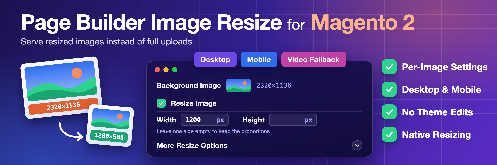
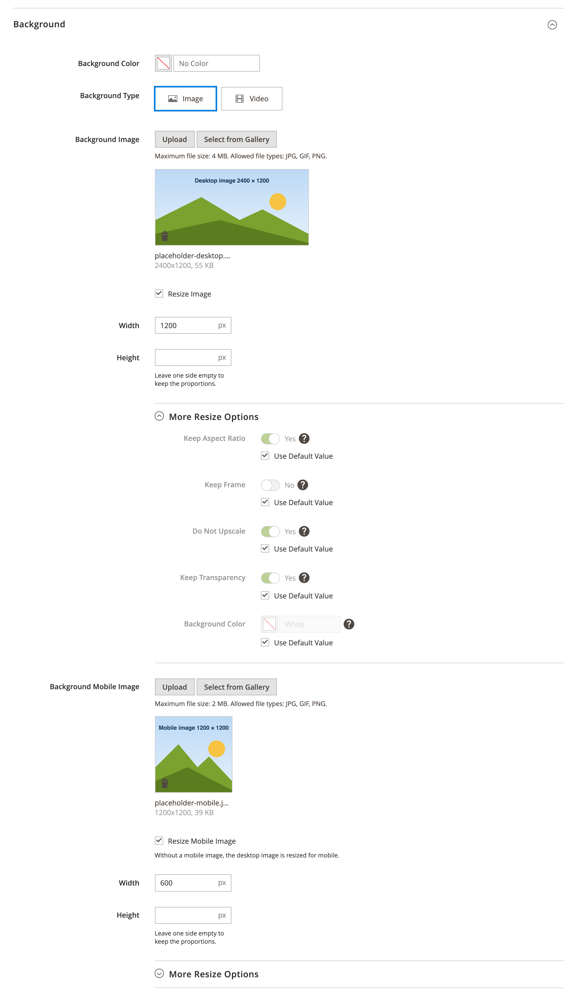
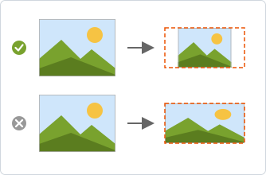
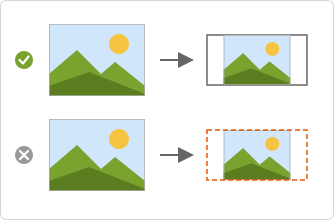
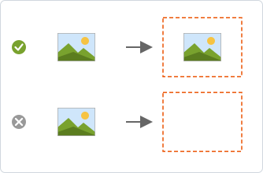
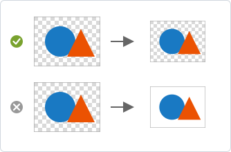
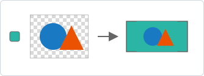

# Friends of Magento Page Builder Image Resize



Page Builder serves every image exactly as it was uploaded. Editors often upload photos straight from a camera or a design tool, thousands of pixels wide and several megabytes, for a banner that shows at 1200 px or a column that shows at 400 px. Page Builder only puts the size into the `width` and `height` of the `` tag, and background images go into the CSS as they are, so the browser still downloads the whole file, on phones too. Pages get heavy, the largest image loads late, and PageSpeed Insights reports "Properly size images".

This module adds the target width and height under each image uploader in Page Builder, separately for desktop and mobile. The storefront then serves a resized copy, made by Magento's own image engine on the first uncached render and kept in `pub/media`. Nobody has to resize files before uploading them, and changing a size is an edit in the admin.

## Compatibility

- **Magento Open Source / Adobe Commerce:** 2.4.7 or later, tested on 2.4.7-p10, 2.4.8-p5 and 2.4.9
- **Mage-OS:** 3.x and 4.x, tested on 3.6.0 and 4.0.0
- **PHP:** 8.1 or later, tested on 8.1 to 8.5

Page Builder is required. Other versions aren't tested and are installed at your own risk.

## Installation

```bash
composer require fom/module-page-builder-image-resize
bin/magento module:enable Fom_PageBuilderImageResize
bin/magento setup:upgrade
bin/magento cache:flush
```

## Where the settings are

A **Resize Image** checkbox sits under each image uploader. Checking it shows **Width** and **Height**, and a closed **More Resize Options** section.

| Content type | Images with a Resize checkbox |
|---|---|
| Image | Image, Mobile Image |
| Row, Banner, Slide | Background Image, Mobile Image, Video Fallback Image |
| Column, Column Group, Tab Item | Background Image, Mobile Image |
| Any other content type with Page Builder background images | Background Image, Mobile Image, and Video Fallback Image when it has one |

Images inside Text and HTML blocks are not covered. To add the checkbox to a content type with its own image uploader, see [Add resize support to a content type](docs/extending.md).

## Screens

| Screen | Image used |
|---|---|
| 768px and up | Desktop |
| 767px and below | Mobile |

Tablets use the desktop image.

- Each screen is resized only by its own settings. A screen without settings gets the original file.
- When no mobile image is uploaded, **Resize Mobile Image** resizes the desktop file for mobile. Without it, mobile gets the original desktop file.
- The video fallback image is one file for all screens, so it has one **Resize Image** checkbox.
- The URLs are replaced on the server before Page Builder renders the page, so themes need no changes.

## Settings

The Background section of a Banner, with the desktop image resized to 1200 px wide and the mobile image to 600 px wide. The desktop **More Resize Options** are open and use the defaults.



| Field | Default | What it does |
|---|---|---|
| Width, Height | Empty | Leave one side empty to keep the proportions. At least one is required. |
| Keep Aspect Ratio | On | Scales the image proportionally. Off stretches it to the exact width and height. <br> |
| Keep Frame | Off | Places the image in a box of exactly width by height and fills the gap with the background color. Requires both width and height. <br> |
| Do Not Upscale | On | Never makes the image larger than the original. A smaller image is served as is. <br> |
| Keep Transparency | On | Keeps the transparent areas of PNG images. Off fills them with the background color. <br> |
| Background Color | White | Fills the frame, and the transparent areas when transparency is not kept. <br> |

Every option under **More Resize Options** starts locked with **Use Default Value** checked. Clear it to change the option. Options that use the default are not saved with the content, so the storefront applies the defaults above.

The same pictures show in the admin when you hover the **?** next to an option.

## How it works

- Files are written to `pub/media/pagebuilder/cache/<hash>/<media path>` on the first uncached render. The Media Gallery does not list this folder.
- A variant is regenerated when its source file is newer.
- A Media Gallery rendition URL is resized from the original upload when that file exists.
- An `` without `width` and `height` gets the size of the resized file.
- The original URL is kept, and the reason logged, when:
    - the URL is outside the store's media URL, or in a folder the web server keeps private: `customer`, `customer_address`, `custom_options`, `downloadable` or `import`
    - the source is missing, or is not JPEG or PNG
    - the source or the resized image would be above 40 megapixels in total (width × height), for example 8000 × 5000 px

Content types with background or video fallback images get the resize attributes when Page Builder loads its configuration in the admin. Run `bin/magento cache:flush` after you install the module or add a content type.

## Flushing

**System > Cache Management > Flush Catalog Images Cache** deletes the variants and cleans the `full_page` and `block_html` caches. If a CDN caches HTML, purge it too, because cached pages can still point at the deleted files.

## Extensibility

Extend the module through [plugins](https://developer.adobe.com/commerce/php/development/components/plugins/) and [dependency injection](https://developer.adobe.com/commerce/php/development/components/dependency-injection/). For step-by-step examples, see [Add resize support to a content type](docs/extending.md).

### Public APIs

- `\Fom\PageBuilderImageResize\Model\Html\ImageRewriterInterface`
    - rewrites the image URL of one kind of image holder in an opening tag
- `\Fom\PageBuilderImageResize\Model\Html\ImageRewriter\AttributeSourceRewriter`
    - resizes the image URL stored in one attribute, for use as a virtual type
- `\Fom\PageBuilderImageResize\Model\Html\ResizeAttributeProcessor`
    - applies the saved resize settings of every tag through the image rewriters
- `\Fom\PageBuilderImageResize\Model\Html\TagAttributes`
    - reads and writes tag attributes in the escaped JSON format Page Builder saves
- `\Fom\PageBuilderImageResize\Model\Image\VariantGenerator`
    - returns the URL and size of a resized variant, or null when the original must be kept
- `\Fom\PageBuilderImageResize\Model\ContentType\ResizeAttributeInjector`
    - adds the resize attributes and converters to content types

### Dependency injection arguments

- `ResizeAttributeProcessor`, `rewriters`
    - the image rewriters, keyed by code: `image`, `background_images` and `video_fallback`
- `ResizeAttributeInjector`, `sources`
    - the attributes that mark a content type element as an image holder, and the resize attributes to add to it
- `ResizeAttributeInjector`, `excludedContentTypes`
    - content types that never get the resize attributes automatically
- `MediaUrlResolver`, `excludedPaths`
    - media folders whose files are never resized, because a resized copy would be public
- `VariantGenerator`, `maxPixels` and `lockTimeout`
    - the largest source and resized image, as the total number of pixels, width × height (default 40000000, that is 40 megapixels), and how many seconds to wait for another process writing the same variant (default 10)

A new resize attribute must also be added to the `allowedAttributes` argument of the `DefaultWYSIWYGValidator` virtual type.

### Events

This module observes the following event:

- `clean_catalog_images_cache_after`
    - deletes the generated variants

### UI components

This module extends the following forms:

- `pagebuilder_image_form`
- `pagebuilder_base_form_with_background_attributes`
- `pagebuilder_base_form_with_background_video`

The form fields use these components from `Fom_PageBuilderImageResize/js/form/element/`:

- `resize-toggle`
    - the Resize Image checkbox, which shows the other fields and requires a width or a height
- `resize-dimension`
    - the Width and Height inputs, required while Keep Frame is on
- `use-default-checkbox` and `use-default-color-picker`
    - an option with Use Default Value and a picture tooltip
- `frame-toggle`
    - the Keep Frame option

The `Fom_PageBuilderImageResize/js/mass-converter/image-resize` mass converter stores the fields of one resize setting in one attribute.

## Examples

[module-page-builder-image-resize-examples](https://github.com/FriendsOfMagento/module-page-builder-image-resize-examples) adds resize support to the FAQ and Quote content types from the official [Page Builder examples](https://github.com/commerce-docs/pagebuilder-examples).
